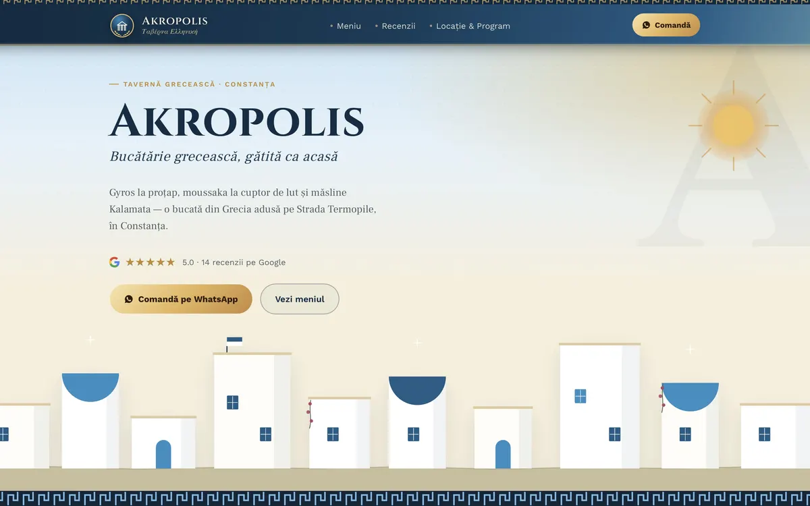

# Akropolis

Site demo pentru o tavernă grecească din Constanța: meniu cu coș de cumpărături, iar comanda pleacă sub forma unui singur mesaj pe WhatsApp, deci restaurantul nu are nevoie de alt sistem de comenzi.

**Live:** [manolacheioan.github.io/akropolis](https://manolacheioan.github.io/akropolis/)

## English summary

Demo site for a fictional Greek taverna in Constanța, Romania: a menu with a cart, and the order is sent as a single pre-filled WhatsApp message, so the restaurant needs no other ordering system. Light and dark theme. Plain HTML, CSS and JavaScript in a single file. Live demo: https://manolacheioan.github.io/akropolis/. The site itself is in Romanian.

## Ce conține

- **Meniu cu coș.** Adaugi preparate, alegi cantitatea și vezi totalul.
- **Comandă pe WhatsApp.** Coșul se transformă într-un singur mesaj, deja scris, către numărul restaurantului.
- **Recenzii** și secțiunea **Locație & Program**.
- **Temă luminoasă și întunecată**, care pornește după setarea dispozitivului.

## Tehnologii

HTML, CSS și JavaScript simplu, într-un singur fișier (`index.html`), fără framework și fără pas de build.

## Rulare

Deschide `index.html` în browser.

## Notă

Proiect demonstrativ: taverna, prețurile, recenziile și datele de contact sunt fictive.

## Autor

Ioan Manolache · [manolacheioan.github.io](https://manolacheioan.github.io)
